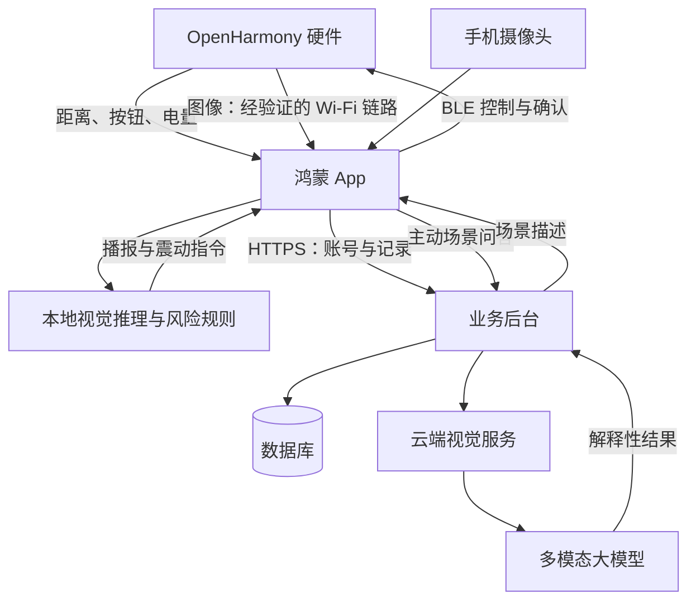
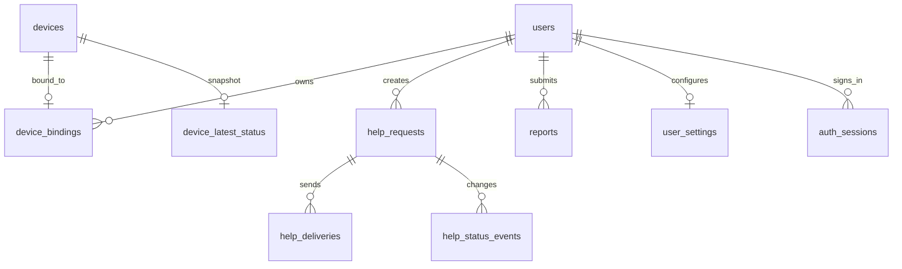
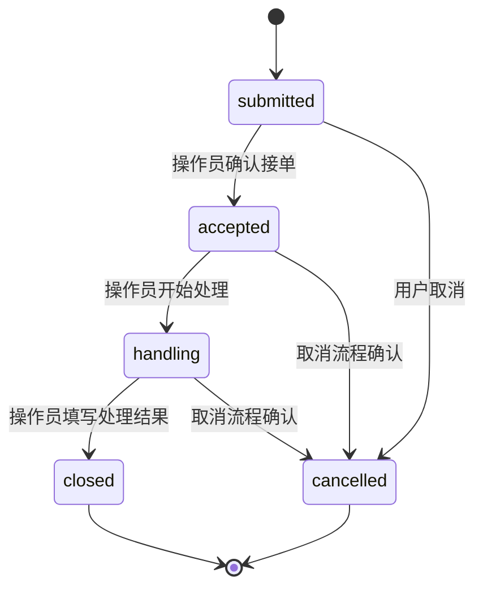
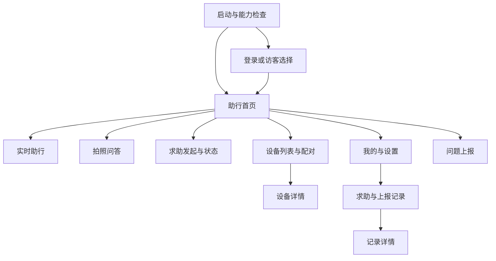

# LenTour 数据库、API 与鸿蒙 App 页面设计（建议稿 v0.1）

日期：2026-10-13。依据：已提供的 README 与讨论中的功能需求。README 确认项目定位为鸿蒙原生多模态智慧助行系统，智能导盲杖、智能墨镜使用 OpenHarmony；并未定义数据库、接口、硬件协议或现有业务实现。本文件是待团队确认的设计，不是现有代码审计结论，也不是已验证的产品能力。

## 1. 先确定系统边界

App 负责页面、读屏、权限、采集、端侧推理、风险规则、语音与设备通信；后台负责账号、设备归属、求助与上报记录；云端视觉与大模型负责用户主动发起的场景解释。实时避障不等待云端、大模型或数据库。



BLE 是拟定的状态、按钮、控制链路；不默认用 BLE 传输持续视频。OpenHarmony 是系统，不是通信协议。目标检测输出类别、框、置信度，并不自动产生可信的米制距离；距离来自已校准的测距传感器或另行验证的深度方案，无法测量时为 null。大模型不直接生成可执行的左右绕行指令。登录失败不应阻断本地助行。

## 2. 数据库设计

MVP 可用一个关系型数据库，暂不要求 Redis 或微服务。下面用 MySQL 风格类型说明，实际选型由现有后台与团队经验决定。

### 2.1 通用约定

- 主键 id 用应用生成的 UUID，CHAR(36)，通过接口以字符串传递。展示编号 user_no 是另一字段，唯一且不可用于授权；“U202610130001”是业务编号，不是 UUID。
- 时间用 DATETIME(3)，数据库和接口统一 UTC；接口输出 ISO 8601，例如 2026-10-13T13:37:49.000Z，页面按用户时区显示。
- 经纬度使用 DECIMAL(10,7)，允许为空；一起为空或一起非空。纬度范围 -90～90，经度 -180～180。同时记录 coordinate_system、accuracy_m、location_observed_at，避免地图坐标混用及旧位置误用。
- created_at、updated_at 用于记录创建和变化。可取消、关闭的业务记录保留状态历史，不以删除代替状态迁移。
- 外键显式设置；记录表不随用户、设备物理删除而级联消失。账号注销与数据删除策略另定，并设置最小保留期限。
- 密码只能保存专用密码哈希，不能明文、可逆加密或普通 SHA 摘要。设备摄像头凭据不写入普通配置文件、接口日志或该数据库模型。

### 2.2 表与字段

|表|核心字段|用途与约束|
|---|---|---|
|users|id PK、user_no UNIQUE、username UNIQUE、password_hash、nickname、role、status、created_at、updated_at|role=user/admin/operator，status=active/disabled；管理员权限由后台检查|
|user_settings|user_id PK/FK、speech_rate、volume、haptic_enabled、large_text_enabled、updated_at|跨设备偏好；本地先保存，登录后同步，不保存摄像头密码|
|devices|id PK、serial_no UNIQUE、device_type、model、firmware_version、created_at、updated_at|设备目录；type=cane/glasses/watch，仅启用已验证的类型|
|device_bindings|device_id PK/FK、user_id FK、bound_at|MVP 一台设备一个当前主人；用户可拥有多台设备；解绑删除当前绑定，审计表记录历史|
|device_latest_status|device_id PK/FK、battery_percent nullable、sensor_health、observed_at、received_at、boot_id、sequence_no|云端最新快照；不使用静态 online 布尔值作为实时状态|
|help_requests|id PK、user_id FK、client_request_id、status、reason、latitude、longitude、coordinate_system、accuracy_m、location_observed_at、version、created_at、updated_at|UNIQUE(user_id,client_request_id)，防重复求助；定位可缺失，不能因此拒绝求助|
|help_deliveries|id PK、help_id FK、channel、delivery_status、provider_reference nullable、attempt_count、last_error nullable、created_at、updated_at|channel 按真正接入的渠道设置；status=queued/sent/failed/acknowledged。无通知渠道时不生成虚假发送成功|
|help_status_events|id PK、help_id FK、from_status、to_status、actor_user_id nullable、note nullable、created_at|每次合法迁移在同一事务写入；仅允许有权限的操作员接单与处理|
|reports|id PK、user_id FK、client_request_id、type、description、status、latitude、longitude、coordinate_system、accuracy_m、location_observed_at、created_at、updated_at|UNIQUE(user_id,client_request_id)；type=obstacle/facility/other，status=submitted/reviewing/resolved/rejected|
|audit_logs|id PK、actor_user_id nullable、action、target_type、target_id、request_id、created_at|设备绑定、管理员处置等审计，不记录密码、令牌、原始图像|
|auth_sessions|id PK、user_id FK、refresh_token_hash UNIQUE、expires_at、revoked_at nullable、created_at|用于刷新会话轮换、退出和撤销，原始刷新令牌不落库|

可选后续表：emergency_contacts（联系人，须确定真实通知链路后再启用）、media_assets（附件元数据，对象存储保存文件，设置访问控制和到期删除）、scene_tasks（异步场景分析任务）。连续视频、每帧检测结果和每次距离读数不默认上传入库。

### 2.3 关系与索引



device_bindings.user_id 建索引；help_requests(user_id,created_at,id)、help_requests(status,created_at,id)、reports(user_id,created_at,id)、help_status_events(help_id,created_at,id) 建复合索引。状态表更新只接受同 boot_id 下更新的 sequence_no；新的启动会话须先验证，避免延迟数据覆盖最新数据。此快照不能替代 App 当前 BLE 连接状态。

### 2.4 求助状态机



业务状态与通知投递状态独立。submitted 只表示服务器保存成功；sent 只表示渠道发送成功；accepted 才表示有人确认接单；closed 不自动意味着用户已脱险。cancelled 必须通知已接单的人员，不能仅修改手机页面。服务端使用 version 与事务控制并发，非法迁移返回 409。

## 3. API 设计

### 3.1 公共规则

前缀 /api/v1；生产环境 HTTPS。普通用户请求使用 Authorization: Bearer <access_token>。服务端从令牌取得 user_id，不能相信请求体传入的 userId；每个对象接口均检查归属。管理员路径还必须检查角色。

响应 HTTP 状态与真实结果一致：成功 200，创建 201，注销无响应体 204；参数错误 400，未登录 401，无权限 403，不存在 404，状态冲突 409，限流 429，依赖暂不可用 503。

```json
{
  "code": "OK",
  "message": "记录已保存",
  "data": {"id": "<uuid>", "status": "submitted"},
  "requestId": "<trace-id>"
}
```

失败仍包含 code、message、requestId；data 可为 null，不将堆栈或内部地址返回给用户。列表使用 limit（默认20，最多100）与不透明 cursor，按 created_at 和 id 排序，返回 items、nextCursor。登录错误不区分“账号不存在”和“密码错误”。

### 3.2 接口目录

|方法与路径|请求内容|响应及权限|
|---|---|---|
|POST /auth/register|username、password、nickname|创建普通用户；禁止客户端指定 role|
|POST /auth/login|username、password|accessToken、expiresIn、refreshToken、用户基本信息；限流|
|POST /auth/refresh|refreshToken|轮换会话令牌，旧刷新令牌作废|
|POST /auth/logout|refreshToken|撤销会话，204；App 清理本地凭据|
|GET /users/me|无|当前用户资料|
|PATCH /users/me|nickname|仅更新允许字段，不更新 role/user_no|
|PUT /users/me/password|oldPassword、newPassword|核验旧密码，修改后撤销会话并重新登录|
|GET /users/me/settings|无|偏好设置|
|PUT /users/me/settings|设置字段|校验语速、音量范围，返回最新值|
|GET /devices|分页参数|当前用户绑定的设备与云端快照|
|POST /devices/bind|serialNo、pairingProof|验证短时配对凭据与设备占有；仅扫描序列号不能绑定|
|DELETE /devices/{id}/binding|无|仅主人解绑，204；保留审计|
|GET /devices/{id}/status|无|快照、observedAt、receivedAt；仅主人|
|PUT /devices/{id}/status|bootId、sequenceNo、observedAt、电量、传感器健康|仅主人且已建立受信设备会话；不是任意 App 数据都可信|
|POST /help-requests|clientRequestId、reason、location nullable|幂等创建，201；重放返回原记录 200|
|GET /help-requests|分页参数|仅自己的记录|
|GET /help-requests/{id}|无|自身记录、业务状态、投递状态、事件历史|
|POST /help-requests/{id}/cancel|reason、expectedVersion|按状态机取消，终态重复取消返回原结果|
|POST /reports|clientRequestId、type、description、location nullable|幂等创建，201；重放 200|
|GET /reports|分页参数|自己的上报记录|
|GET /reports/{id}|无|自身记录详情|
|POST /ai/scene-descriptions|multipart：image、question、clientRequestId|在线场景解释；响应 text、limitations、modelVersion；严格超时、容量与调用额度限制|
|GET /admin/help-requests|status、分页参数|管理员/操作员可访问的待处理列表|
|PATCH /admin/help-requests/{id}/status|status、note、expectedVersion|授权操作员执行合法迁移，写审计|
|PATCH /admin/reports/{id}/status|status、note|管理员审核；写审计|

配对凭据的生成、验签与挑战机制须随硬件协议一起确定，不能用永久共享密码代替。注册功能也可按演示范围关闭，由管理员预建测试账号。

### 3.3 求助请求示例

```json
{
  "clientRequestId": "8f7c15ac-3b14-4e81-9b25-59b10f678d4c",
  "reason": "需要协助",
  "location": {
    "latitude": 31.2304000,
    "longitude": 121.4737000,
    "coordinateSystem": "WGS84",
    "accuracyM": 18.0,
    "observedAt": "2026-10-13T13:37:49.000Z"
  }
}
```

坐标仅为字段示例，不代表用户位置；实际 coordinateSystem 必须跟随定位来源。位置失败时传 null。clientRequestId 在用户首次发起时生成，网络重试不得换号。UNIQUE 约束与事务防止并发创建；同用户同 ID 不同请求内容返回 409 IDEMPOTENCY_CONFLICT，不能悄悄覆盖旧记录。

断网时 App 本地生成 pending_sync 操作并显示“尚未发送”，保存请求 ID 与原始时间。重新联网后先显示待发送项，请用户确认仍需发送，避免过时求助被静默重发；已发送但响应丢失的请求可用原 ID 安全重试。没有账号时本地助行仍可用，远程求助须有独立的访客身份方案；MVP 不伪装未接入的远程求助。

### 3.4 AI 与硬件协议的边界

本地检测数据格式建议：

```json
{
  "eventId": "<uuid>",
  "frameId": "<frame-id>",
  "observedAt": "2026-10-13T13:37:49.000Z",
  "label": "person",
  "confidence": 0.93,
  "direction": "front",
  "distanceM": null,
  "distanceSource": "unknown",
  "riskLevel": "unknown",
  "expiresAt": "2026-10-13T13:37:50.000Z"
}
```

这是内部事件，不是每帧上传后台的接口；示例有效期并非经过测试的阈值。riskLevel 来自本地规则与可靠传感器，不等同于模型 confidence。实际有效期、风险阈值、端到端延迟必须在目标设备上测量并确定。

硬件控制协议需包含 protocolVersion、sessionId、commandId、sequenceNo、TTL、eventType、patternId；设备回 ACK 并报告执行结果。MVP 先定义三种容易区分的震动：注意、紧急提示、操作确认，持续时间与重复次数交由使用者测试确定。重试使用原 commandId，设备去重；TTL 到期不执行，断连立即显示反馈通道不可用。App 语音播报做优先级、去重和冷却，紧急提示可以打断低优先级场景描述。

## 4. 鸿蒙 App 页面与代码结构

### 4.1 导航关系



首页入口数量和顺序需进行读屏测试。可使用“助行、设备、我的”三个主导航；求助是各主要页面可达的固定动作，不藏在设置。求助确认需要同时有触控和读屏可操作方式，不设计只能长按的入口。

### 4.2 页面、数据、验收一一对应

|页面|用户完成什么|依赖|必须具备的状态/验收|
|---|---|---|---|
|启动/登录|进入本地助行或登录|AuthService|登录服务不可用仍可访客进入；令牌过期不终止本地助行|
|助行首页|了解当前能力并开始助行|AssistStore、DeviceStore|分开显示摄像头、传感器、反馈通道可用性；不以云端在线替代 BLE 连接|
|实时助行|开始/暂停、听取风险提醒|CameraService、VisionService、RiskEngine、SpeechService、DeviceService|运行中、已暂停、权限拒绝、模型不可用、传感器异常、断连分别提示|
|拍照问答|拍照并询问场景|CameraService、SceneApi|加载、取消、超时、重试、结果过期；明确云端不可用，不阻塞实时助行|
|求助|发起、确认发送、了解处理进度、取消|HelpApi、HelpOutbox|未发送/已保存/投递失败/已接单分别展示和播报；定位失败仍能发起|
|问题上报|说明障碍或设施问题|ReportApi、ReportOutbox|草稿、待同步、已提交、审核状态；防重复提交|
|设备列表/配对|发现并绑定硬件|DeviceService、DeviceApi|无设备、蓝牙关闭、权限拒绝、配对失败、已被绑定、配对成功|
|设备详情|查看真实连接、电量、传感器与测试反馈|DeviceStore、设备 ACK|云端快照显示时间；断连不能显示在线；发送命令不等于执行成功|
|我的/设置|偏好、密码、权限说明、退出|SettingsStore、UserApi|设置本地立即生效，云端同步失败有状态；不覆盖系统读屏设置|
|记录列表/详情|查询求助、上报及状态历史|HelpApi、ReportApi|加载、空列表、网络失败、分页；仅展示授权记录|

管理员处置页面放在独立管理端，不默认与视障用户的主要导航混在一起。桌面卡片安排在核心流程稳定后；卡片提示刷新时间，点击进入 App 后重新检查状态。

### 4.3 建议源码目录

|目录|文件示例|职责|
|---|---|---|
|entry/src/main/ets/pages/|HomePage.ets、WalkPage.ets、HelpPage.ets、DevicePage.ets|页面布局与交互，不直接编写网络和 BLE 协议|
|entry/src/main/ets/components/|AccessibleAction.ets、DeviceStatusCard.ets、ErrorState.ets|复用 UI 及读屏语义|
|entry/src/main/ets/models/|HelpRequest.ets、DeviceStatus.ets、RiskEvent.ets|共享数据结构与枚举|
|entry/src/main/ets/services/api/|AuthApi.ets、HelpApi.ets、ReportApi.ets、DeviceApi.ets|HTTP、令牌处理、响应校验与异常转换|
|entry/src/main/ets/services/platform/|CameraService.ets、SpeechService.ets、PermissionService.ets|平台能力适配及资源释放|
|entry/src/main/ets/services/device/|DeviceService.ets、ProtocolCodec.ets|连接、协议编码、ACK、超时与重连|
|entry/src/main/ets/services/assist/|VisionService.ets、RiskEngine.ets、FeedbackScheduler.ets|视觉推理、风险规则与反馈调度|
|entry/src/main/ets/stores/|AssistStore.ets、DeviceStore.ets、UserStore.ets|页面可订阅的业务状态|
|entry/src/main/ets/repositories/|HelpOutbox.ets、ReportOutbox.ets、SettingsRepository.ets|本地草稿、同步与幂等 ID|
|entry/src/main/ets/config/|Environment.ets|开发/测试/生产地址，不存密钥与密码|

组件命名、状态管理写法、权限名和生命周期 API 要根据目标 HarmonyOS SDK 版本确认，本方案不把讨论里的 contentDescription、SpeechKit 等名称当作已验证的 ArkUI API。智能体编排可放在 services/assist 后续扩展，MVP 不必先拆多个 Agent。

### 4.4 无障碍与生命周期要求

- 按钮提供清晰名称、状态和操作反馈；页面焦点顺序与视觉顺序一致；危险信息不只用颜色表示。
- 应用 TTS 与系统读屏避免重复播报，测试读屏开启时的焦点切换、按钮名称、错误提示和动态状态变化。
- 摄像头、麦克风、定位、蓝牙权限在用到时分别说明；被拒绝后告知哪项能力不可用并提供可操作替代。
- 显式区分应用前台/后台、助行运行/暂停、云端在线/离线、设备连接/断连；普通页面刷新停掉不代表助行一定停止。
- 退到后台的摄像头、语音、BLE 能否持续工作取决于 SDK、设备及系统策略，必须实测；被暂停或终止时可感知地告知用户，不能假装仍在监测。

## 5. 分工与交付顺序

|负责人|交付物|对接方|验收证据|
|---|---|---|---|
|后台负责人|数据库迁移、接口实现、认证、幂等、求助状态机|App、管理端|越权拒绝、重复提交不重复入库、通知失败可见|
|App 负责人|页面、状态、权限、网络及本地待发送队列|后台、AI、硬件|访客本地助行、断网状态、读屏操作完整|
|AI 负责人|模型、输入规格、检测结构、目标设备性能报告|App、硬件|误检漏检样例、延迟、距离字段来源与限制|
|硬件负责人|协议、配对、状态、命令 ACK、传感器反馈|App、AI|断连、重连、过期命令、重复命令、电量验证|
|联调负责人|协议版本、场景测试、演示清单|各模块|从采集到反馈、从求助到接单的完整记录|

人少时可以一人兼任，但每项交付只有一个最终负责人。后台管理员与测试并不等于 App 组自动承担所有安全和接口工作。

建议顺序：① 锁定目标 SDK、硬件与协议字段；② 完成手机采集/真实模型/本地提示的最小闭环，同时让硬件验证测距和震动；③ 完成真实求助记录及明确的通知、接单链路；④ 接入配对、硬件状态与 ACK；⑤ 优化无障碍、状态恢复、场景问答与桌面卡片。无障碍、权限和异常处理贯穿全部阶段，不留到最后。模拟数据只能用于开发或明确标注的演示模式。

## 6. 最小联调清单

1. 手机采集→目标设备推理→本地风险规则→播报；记录时间戳，测端到端延迟而不只测模型耗时。
2. 测距失效、低光、遮挡、模型失败时提示能力受限，不生成虚假安全结论或精确距离。
3. 手机与设备断连后，界面和语音提示正确；旧命令不在重连后执行，ACK 丢失重试不重复震动。
4. 求助按钮重复点击、超时重试与服务端并发提交只生成一条记录。
5. 定位拒绝、无网络、通知失败、无人接单分别呈现真实状态；断网求助恢复后不自动发送过时请求。
6. 用户 A 不能读取用户 B 的设备、求助、上报记录，普通用户不能通过请求体提升角色。
7. 管理员同时修改记录时，版本冲突返回 409；状态与事件历史一致。
8. 读屏打开时完成开始助行、暂停、求助、取消与查看状态，不依赖颜色或只能长按的操作。
9. 前后台切换与锁屏实测，明确哪些能力能持续运行、哪些被系统停止。

需要团队补充：完整业务源码、SDK 版本、目标硬件与传感器、真实通知渠道、现有后端技术栈、人员和工期。未提供这些信息前，不承诺任意设备上的后台运行能力、模型速度或实际导航安全性。
